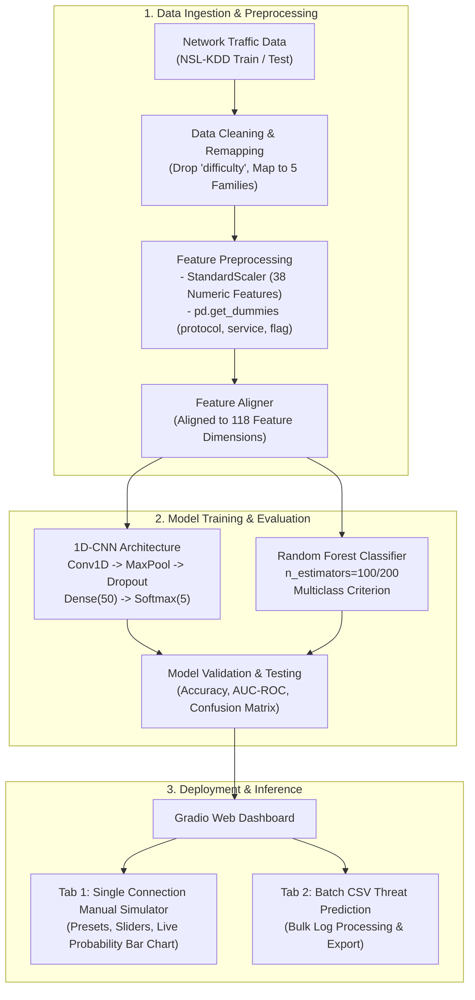

# 🛡️ Intelligent Intrusion Detection System (I-NIDS)

[](https://www.python.org/)
[](https://tensorflow.org/)
[](https://scikit-learn.org/)
[](https://gradio.app/)
[](LICENSE)

An end-to-end, AI-powered **Network Intrusion Detection System (NIDS)** that evaluates network traffic flows and classifies malicious activity into five macro threat categories. Built with a dual-model architecture comparing **1D-Convolutional Neural Networks (1D-CNN)** and ensemble **Random Forest** classifiers, and deployed with a live, interactive **Gradio** web application.

---

## 📌 Table of Contents
- [Project Overview](#-project-overview)
- [System Architecture](#-system-architecture)
- [Dataset & Threat Classification](#-dataset--threat-classification)
- [Machine Learning & Deep Learning Models](#-machine-learning--deep-learning-models)
- [Experimental Results & Evaluation](#-experimental-results--evaluation)
- [Interactive Web Application (Gradio)](#-interactive-web-application-gradio)
- [Installation & Getting Started](#-installation--getting-started)
- [Project Structure](#-project-structure)
- [Key Engineering Insights](#-key-engineering-insights)
- [Future Roadmap](#-future-roadmap)
- [Author & Acknowledgments](#-author--acknowledgments)

---

## 🔍 Project Overview

Modern enterprise networks face continuous, evolving cyber threats ranging from stealthy reconnaissance probes to volumetric Denial of Service (DoS) attacks. Traditional signature-based Intrusion Detection Systems (IDS) frequently fail to detect zero-day exploits and polymorphic threat vectors.

This project delivers:
- **Comprehensive Preprocessing**: Automated standardization of 38 numeric flow metrics and categorical alignment across 118 engineered feature dimensions.
- **Dual Model Implementation**:
  - **1D-CNN**: Extracts spatial correlations and non-linear patterns across network traffic vectors.
  - **Random Forest**: High-performance ensemble learning providing rapid tabular classification and feature importance interpretability.
- **Interactive UI**: A multi-tab Gradio dashboard supporting **manual connection simulation** with sample threat presets and **bulk CSV log auditing**.

---

## 🏗️ System Architecture



---

## 📊 Dataset & Threat Classification

Trained and evaluated on the widely recognized **NSL-KDD** benchmark dataset (`KDDTrain+` with 125,973 samples and `KDDTest+` with 22,544 samples). The raw network records contain 41 connection attributes mapped into **5 macro classes**:

| Class | Type | Description | Representative Attack Types |
| :--- | :--- | :--- | :--- |
| **Normal** | Benign | Legitimate user and system traffic | Standard HTTP, SSH, FTP, DNS requests |
| **DoS** | Attack | Denial of Service; aims to exhaust server resources | `neptune`, `smurf`, `pod`, `teardrop`, `apache2` |
| **Probe** | Attack | Surveillance, port scanning, network topology mapping | `ipsweep`, `portsweep`, `nmap`, `satan`, `mscan` |
| **R2L** | Attack | Remote-to-Local; gaining unauthorized local access from remote | `guess_passwd`, `warezclient`, `snmpguess`, `imap` |
| **U2R** | Attack | User-to-Root; exploiting vulnerabilities to elevate local privileges | `buffer_overflow`, `rootkit`, `loadmodule`, `perl` |

---

## 🧠 Machine Learning & Deep Learning Models

### 1. 1D Convolutional Neural Network (1D-CNN)
```
Input (118, 1)
  │
  ├── Conv1D(filters=32, kernel_size=3, padding='same', activation='relu')
  ├── MaxPooling1D(pool_size=4)
  ├── Dropout(rate=0.2)
  │
  ├── Conv1D(filters=32, kernel_size=3, padding='same', activation='relu')
  ├── MaxPooling1D(pool_size=4)
  ├── Dropout(rate=0.2)
  │
  ├── Flatten()
  ├── Dense(50, activation='relu')
  └── Dense(5, activation='softmax') -> [DoS, Probe, R2L, U2R, Normal]
```
- **Loss**: Categorical Crossentropy
- **Optimizer**: Adam
- **Training Strategy**: 100 Epochs, Batch Size 5000, 20% validation split

### 2. Random Forest Classifier
- **Estimators**: 100 / 200 Decision Trees
- **Class Splitting**: Gini impurity / parallelized execution (`n_jobs=-1`)
- **Advantage**: Fast training time and high resilience against noise.

---

## 📈 Experimental Results & Evaluation

Evaluated against the full test set (**`KDDTest+`** consisting of 22,544 connections):

### Overall Performance Comparison
| Metric | 1D-CNN | Random Forest |
| :--- | :---: | :---: |
| **Test Accuracy** | **75.33%** | **75.12%** |
| **Validation Accuracy (Train Split)** | **99.23%** | **~99.8%** |
| **Test Loss** | 1.7125 | N/A |

### Random Forest Classification Report
```
              precision    recall  f1-score   support

         Dos       0.96      0.78      0.86      7460
       Probe       0.84      0.61      0.70      2421
         R2L       0.98      0.06      0.11      2885
         U2R       0.60      0.04      0.08        67
      normal       0.65      0.97      0.78      9711

    accuracy                           0.75     22544
   macro avg       0.80      0.49      0.51     22544
weighted avg       0.81      0.75      0.71     22544
```

> **Why the Train-Test Accuracy Gap (~99% vs ~75%)?**  
> The NSL-KDD `KDDTest+` dataset contains **novel zero-day attack sub-types** that do not exist in the training set (`KDDTrain+`). Specifically, new R2L and U2R attacks were introduced to measure generalized detection of unseen threats. When attacks match known signatures, precision is exceptionally high (0.98 for R2L, 0.96 for DoS).

---

## 🖥️ Interactive Web Application (Gradio)

The application provides a security analyst dashboard with:
1. **Interactive Manual Simulator**:
   - Sliders and dropdowns for duration, service, protocol, error rates, and connection counters.
   - Quick load sample presets: `Normal HTTP Traffic`, `Neptune SYN Flood`, `Smurf ICMP Flood`, `Port Sweep (Probe)`.
   - Dynamic Matplotlib prediction probability bar chart with color-coded confidence levels.
2. **CSV Batch Audit**:
   - Upload any CSV matching the network feature schema.
   - Instant multi-sample threat classification output in tabular format.

---

## 💻 Installation & Getting Started

### 1. Clone the Repository
```bash
git clone https://github.com/ArsalArain/intelligent-intrusion-detection.git
cd intelligent-intrusion-detection
```

### 2. Set Up a Virtual Environment
```bash
# Windows (PowerShell)
python -m venv .venv
.\.venv\Scripts\Activate.ps1

# Linux / macOS
python3 -m venv .venv
source .venv/bin/activate
```

### 3. Install Required Dependencies
```bash
pip install -r requirements.txt
```

### 4. Run the Application
Open and execute [final-is-project.ipynb](final-is-project.ipynb) in Jupyter Lab, VS Code, or Kaggle/Google Colab, or execute the Gradio cell directly to launch the local web server:
```bash
# Launches local Gradio server at: http://127.0.0.1:7861
```

---

## 📁 Project Structure

```plaintext
intelligent-intrusion-detection/
├── final-is-project.ipynb   # Complete pipeline: EDA, training, evaluation & Gradio app
├── label_encoder.pkl        # Serialized LabelEncoder mapping classes to integers
├── numeric_columns.json     # Feature list for numeric StandardScaler transformation
├── onehot_columns.json      # Aligned 118-column feature schema for inference
├── requirements.txt         # Project dependencies
├── .gitignore               # Ignored files, temp artifacts & cache
└── README.md                # Project documentation
```

---

## 💡 Key Engineering Insights

1. **Feature Alignment is Crucial**: One-hot encoding on dynamic categorical features (`service` has 66+ categories) can cause dimensionality mismatches between inference and training. Storing and enforcing `onehot_columns.json` guarantees strict schema compliance.
2. **Class Imbalance in Cybersecurity**: Critical intrusions like User-to-Root (`U2R`) represent less than 0.3% of traffic. Standard cross-entropy loss tends to favor majority classes (`normal` and `DoS`), highlighting the need for cost-sensitive learning or anomaly-based pre-filtering.

---

## 🚀 Future Roadmap

- [ ] Implement **SMOTE / ADASYN** to mitigate severe imbalance in minority classes (U2R / R2L).
- [ ] Implement a **Two-Stage Hybrid Detector**:
  - *Stage 1*: Anomaly detection (Isolation Forest / Autoencoders) for zero-day threat discovery.
  - *Stage 2*: Multi-class classifier for known signature classification.
- [ ] Export models to **ONNX runtime** and containerize via **Docker** for Kubernetes edge deployment.

---

## 👤 Author

**Arsal Arain**  
- GitHub: [@ArsalArain](https://github.com/ArsalArain)
- Email: arsalarain72@gmail.com

---

## 📜 License
This project is open-source and available under the [MIT License](LICENSE).
